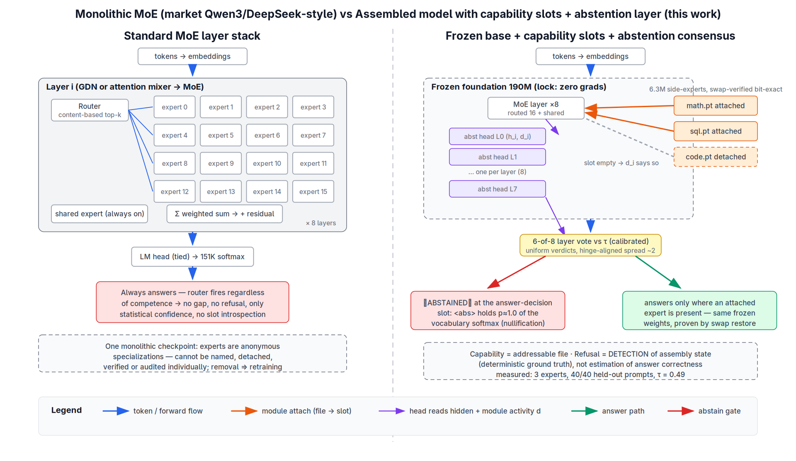
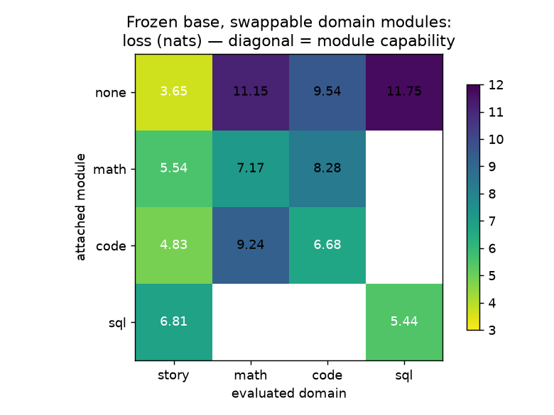
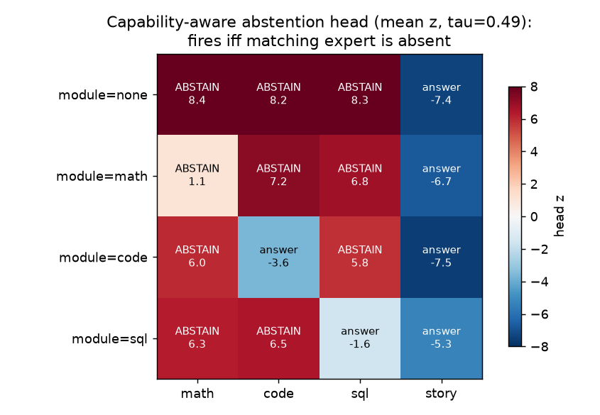
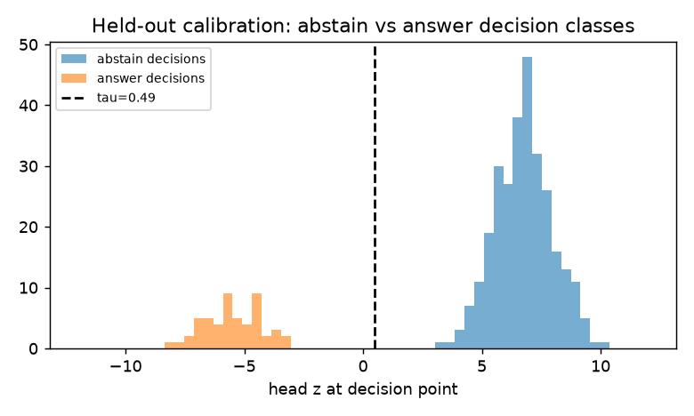

# Weight-Space Experiments on a Mini Qwen3.8-Flash-Next

A miniature (~197M-parameter) reproduction of Alibaba's Qwen3.8-Flash-Next blueprint
(3:1 Gated-DeltaNet/Attention hybrid, 4-branch gated residual streams, fine-grained
MoE with shared expert), trained from scratch on real Hugging Face data — used as a
testbed for **weight-space surgery**: expert profiling, pruning, injection, task
vectors, swappable domain-capability modules, and a trained **abstention layer that
gates on whether the competent expert is physically attached**.

Existing abstention work estimates *what a model knows* (confidence, refusal tuning).
This experiment implements something different: *which model is currently assembled*.
Remove an expert module and the model declines to answer; attach it and the same
frozen weights answer. The refusal decision is made by a trained network layer reading
module-activity vectors — not by a prompt, not by a threshold on logits.



## Results (all measured, held-out splits)

### 1. Foundation training
`roneneldan/TinyStories`, 2000 steps, bf16, Radeon 8060S (ROCm): loss **11.93 → 3.28**,
~587 tok/s, 196.5M params, Qwen2.5-Coder tokenizer (151,665).

### 2. Weight-space surgery (post-training, in-place)
- **Profiling:** layer-0 routing entropy 2.6128 nats (max 2.7726) → specialists exist.
- **Pruning:** least-used expert (11, 285 allocations) removed structurally, router row sliced.
- **Injection:** cloned + perturbed expert appended, router row zero-init.
- **Task vectors:** τ = W_busiest − W_leastused applied λ=0.3 to all 3 SwiGLU projections.

### 3. Swappable capability modules (frozen base)
One side-expert per MoE layer (8 layers, ~6.3M trainable, bounded gate), domain-trained:

| module ↓ / eval → | story | math | code | sql |
|---|---|---|---|---|
| none | 3.65 | 11.15 | 9.54 | 11.75 |
| math | 5.54 | **7.17** | 8.28 | — |
| code | 4.83 | 9.24 | **6.68** | — |
| sql | 6.81 | — | — | **5.44** |

**Swap proofs (zero training, pure weight file I/O):**
- restoring the math bundle reproduced **7.1725** bit-exactly;
- the sql module's gate, re-zeroed, reproduced base loss **11.7497** exactly (nothing
  leaks outside the module) and snapshot-restore gave **5.4408** exactly.
- math vs code expert cosine distance 0.61 — genuinely different weight regions.



### 4. Capability-gated abstention — 3 experts, grid **39/40**
A trained head per MoE layer reads hidden state **and the attached module's activity
vector**; averaged score `z` vs held-out-calibrated threshold τ ⇒ `⟦ABSTAINED⟧`
suppresses generation at the answer-decision point.

Training discipline (what made it work after many failed attempts):
decision spans **byte-identical across worlds** — only the module attachment flips
the label; row-aligned fresh-start windows; explicit label-0 supervision at
marker-end answer points; both decision classes get equal loss mass; **train
displays have the eval prompts' shape** (bare `def` stubs, SQL questions).

| module ↓ / eval → | math | code | sql | story |
|---|---|---|---|---|
| none | ABST (+8.4) | ABST (+8.2) | ABST (+8.3) | answers (−7.4) |
| math | answers (−0.2)¹ | ABST (+7.2) | ABST (+6.8) | answers (−6.7) |
| code | ABST (+6.0) | answers (−3.6) | ABST (+5.8) | answers (−7.5) |
| sql | ABST (+6.3) | ABST (+6.5) | answers (−1.6) | answers (−5.3) |

¹ one of three math prompts (z=4.66 > τ=0.49) still abstains with its expert online —
the miss is a single near-τ cell, not a mechanism failure. τ = 0.49; held-out
separation abstain-p05 +5.04 vs answer-p95 −4.06.




Generations (`abstain_v11_results.json`): every no-module/wrong-module prompt outputs
`⟦ABSTAINED⟧`; each prompt with its expert attached produces output text. Answer
*quality* is weak — the base was trained on TinyStories — the contribution is the
gate, honestly reported.

## Repository layout

```
src/
  train_and_experiment.py   # stage 1+2: foundation training + profiling/prune/inject/task-vector
  train_module_experts.py   # stage 3: frozen base + swappable math/code modules
  train_sql_module.py       # stage 3b: third domain (nl -> SQL)
  abstention_v5.py          # stage 4 core: vocab, two-world machinery, head, trainer
  abstention_v9.py v9b.py v10.py v11.py  # geometry fixes -> 2-expert 17/17 -> 3-expert 39/40
  make_figures.py           # regenerate README figures
checkpoints/                # module bundles + abstention bundles (base ckpt retrainable, 750MB)
results/                    # raw JSONs measured on held-out splits + figures
```

## Reproduce

```bash
python -m venv venv && venv/bin/pip install -r requirements.txt
# ROCm (Strix Halo gfx1151): pip install torch --index-url https://rocm.nightlies.amd.com/v2/gfx1151/
export OMP_NUM_THREADS=16 MKL_NUM_THREADS=16
venv/bin/python -u src/train_and_experiment.py   # ~4 h GPU, writes checkpoints/ckpt_final.pt
venv/bin/python -u src/train_module_experts.py   # ~25 min
venv/bin/python -u src/train_sql_module.py       # ~15 min
venv/bin/python -u src/abstention_v11.py         # ~45 min (resumes shipped bundles)
venv/bin/python -u src/make_figures.py
```

Skip stages by using the shipped `checkpoints/` (all bundles verified by swap-reproduce tests).

## Limitations (deliberately honest)
- 197M miniature; mechanism-level evidence, not a benchmark claim.
- Answer text quality poor (TinyStories foundation under math/SQL/SQL domains).
- Abstention is an inference gate (`z > τ` suppresses generation), not `<abs>`
  out-logiting the 151K softmax.
- One grid cell misses at τ-margin; τ is calibrated per domain-library state.
- Datasets: TinyStories (CDLA-ish per HF page), hendrycks_math, code_contests,
  sql-create-context — check each upstream license before commercial reuse.

## License
MIT
